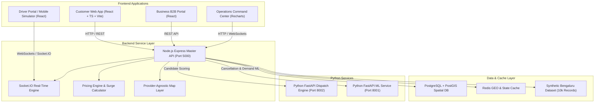

# EasyRide — Intelligent Urban Mobility & Delivery Dispatch Platform

> **One intelligent dispatch network for rides, packages, quick-commerce deliveries and business/service logistics.**

---

## 1. Project Vision & Architecture

EasyRide solves urban logistics fragmentation by unifying dispatch logic across multiple transport and delivery use cases:
- **Ride-Hailing**: Hatchbacks, Sedans, SUVs, Auto-rickshaws, Bike-taxis.
- **Package Delivery**: Person-to-person instant parcel & document delivery.
- **Quick Commerce**: 15-minute ultra-fast delivery dispatches from dark stores.
- **Business Logistics**: Scheduled mini-truck/van commercial deliveries.
- **Service Mobility**: Technician/service professional movement with toolsets.

### System Architecture Diagram



---

## 2. Tech Stack

- **Frontend**: React 18, TypeScript, Vite, Tailwind CSS, Recharts, Leaflet / OpenStreetMap, Lucide Icons, Zustand
- **Backend API**: Node.js, Express.js, TypeScript, Socket.IO, Zod, JWT, bcryptjs, Swagger / OpenAPI
- **Intelligent Dispatch Engine**: Python 3.11+, FastAPI, NumPy, Pandas, Scipy, OR-Tools
- **Machine Learning Service**: Python 3.11+, FastAPI, Scikit-Learn, Random Forest, Logistic Regression, XGBoost, Joblib
- **Database & Spatial Indexing**: PostgreSQL 15 + PostGIS extension, Redis GEO
- **Containerization**: Docker, Docker Compose

---

## 3. Monorepo Directory Structure

```text
easyride/
├── apps/
│   ├── web/                     # Master React Customer/Admin/Business Frontend
│   └── driver-mobile/           # Standalone Driver Mobile App Simulator
├── services/
│   ├── api/                     # Node.js Express REST API & Socket.IO Server
│   ├── dispatch-engine/         # Python FastAPI Multi-Metric Dispatch Engine
│   └── ml-service/              # Python FastAPI ML Prediction & Diagnostics Service
├── packages/
│   ├── shared-types/            # Shared TypeScript Domain Models & Interfaces
│   ├── validation/              # Shared Zod Validation Schemas
│   └── config/                  # Bengaluru Zones, Pricing & Scoring Configuration
├── database/
│   ├── migrations/              # SQL Database Migration Scripts
│   ├── seeds/                   # Synthetic Bengaluru Mobility Dataset (10,000 Bookings)
│   └── schema/                  # Full PostGIS DDL Schema Definitions
├── scripts/
│   ├── generate_dataset.py      # Bengaluru Spatial Dataset Generator
│   ├── seed.js                  # Seed Command Wrapper
│   ├── dev.js                   # Concurrent Development Runner
│   └── simulate.js              # Live Operational Traffic Simulator
├── docker/                      # Service Dockerfiles
├── docker-compose.yml           # Complete Infrastructure Docker Compose Stack
├── .env.example                 # Documented Environment Variables Template
├── package.json                 # Monorepo Workspace Configuration
└── README.md                    # Project Documentation
```

---

## 4. Quick Start & Local Running

### Prerequisites
- **Node.js**: v18.0 or higher
- **Python**: v3.11 or higher (optional for ML features, fallback enabled)

### Installation

1. **Clone the Repository & Install Dependencies**:
   ```bash
   npm install
   ```

2. **Generate Synthetic Bengaluru Mobility Dataset**:
   ```bash
   npm run seed
   ```

3. **Start Full-Stack System**:
   ```bash
   npm run dev
   ```
   - **Frontend App**: `http://localhost:5173` or `http://localhost:3000`
   - **Node API Server**: `http://localhost:5000/api/v1`
   - **Swagger API Docs**: `http://localhost:5000/api/docs`

4. **Run Live Operational Traffic Simulation**:
   In a separate terminal window:
   ```bash
   npm run simulate
   ```

---

## 5. Demo Credentials

| User Role | Email | Demo Capabilities |
| :--- | :--- | :--- |
| **Customer** | `customer@easyride.com` | Booking rides, package express, quick commerce, live map tracking, payment & rating |
| **Driver** | `driver@easyride.com` | ONLINE/OFFLINE toggle, receiving job offers, ETA navigation, trip OTP start/complete |
| **Business** | `business@easyride.com` | Single/multi delivery job creation, bulk CSV upload, delivery tracking, API credentials |
| **Admin** | `admin@easyride.com` | Live city operations map, demand/supply DSR monitoring, Recharts analytics, ML diagnostics |

---

## 6. Docker Deployment

To launch the complete containerized stack (Postgres + PostGIS, Redis, Node API, Python ML Service, Python Dispatch Engine, Nginx Web App):

```bash
docker compose up --build
```

---

## 7. Intelligent Dispatch Scoring Formula

Candidates are scored using hard constraints filtering followed by multi-metric weighted scoring:

$$\text{Score} = 0.30 \times S_{\text{prox}} + 0.20 \times S_{\text{eta}} + 0.20 \times P_{\text{accept}} + 0.15 \times S_{\text{util}} + 0.10 \times S_{\text{earn}} + 0.05 \times S_{\text{dest\_demand}}$$

Where:
- $S_{\text{prox}}$: Proximity score normalized to pickup radius ($0-1$).
- $S_{\text{eta}}$: Estimated time of arrival score.
- $P_{\text{accept}}$: Predicted probability of driver accepting the job.
- $S_{\text{util}}$: Utilization balance factor (prioritizes less congested partners).
- $S_{\text{earn}}$: Fair earning distribution score.
- $S_{\text{dest\_demand}}$: Encourages driver movement towards high demand zones.

---

## 8. API Documentation Overview

Full interactive OpenAPI Swagger documentation is available at `/api/docs`.

Key Endpoints:
- `POST /api/v1/auth/register` & `POST /api/v1/auth/login`
- `POST /api/v1/pricing/estimate`
- `POST /api/v1/bookings`
- `POST /api/v1/drivers/go-online` & `POST /api/v1/drivers/location`
- `POST /api/v1/businesses/deliveries`
- `GET /api/v1/analytics/overview` & `GET /api/v1/analytics/demand`

---

## 9. Known Limitations & Scaling Recommendations

1. **Standalone Execution Fallback**: When PostgreSQL or Redis managed services are offline, the backend uses a high-fidelity spatial in-memory engine with exact Haversine formulas.
2. **Production Scaling**: For massive multi-city scale (> 100,000 active drivers), migrate Redis GEO to distributed Redis Sentinel clusters and deploy Python dispatch workers via BullMQ / Celery worker pools.
